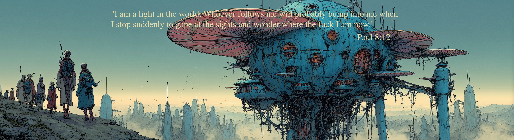

### Art

Visual interpretations of the fractal. Paintings, drawings, photographs, and other artifacts that express Fractalism through image.

#### Contents

*Paul Schmaldinst.*

Return to [Contributions](../README.md)
